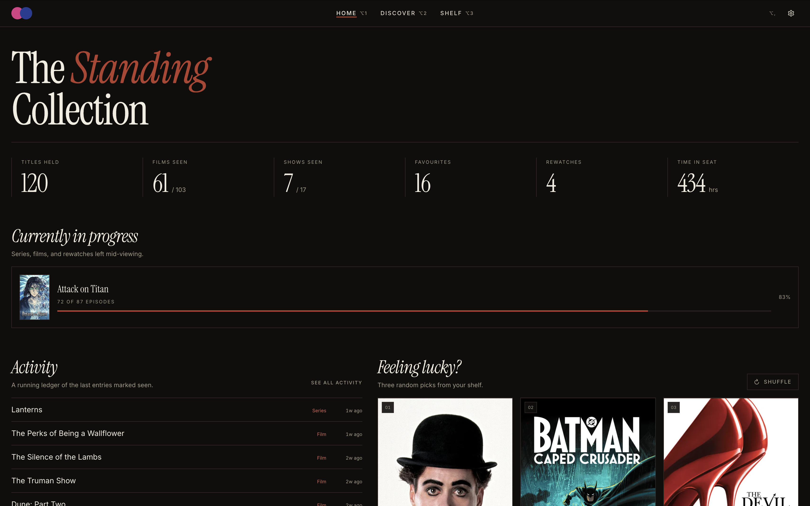
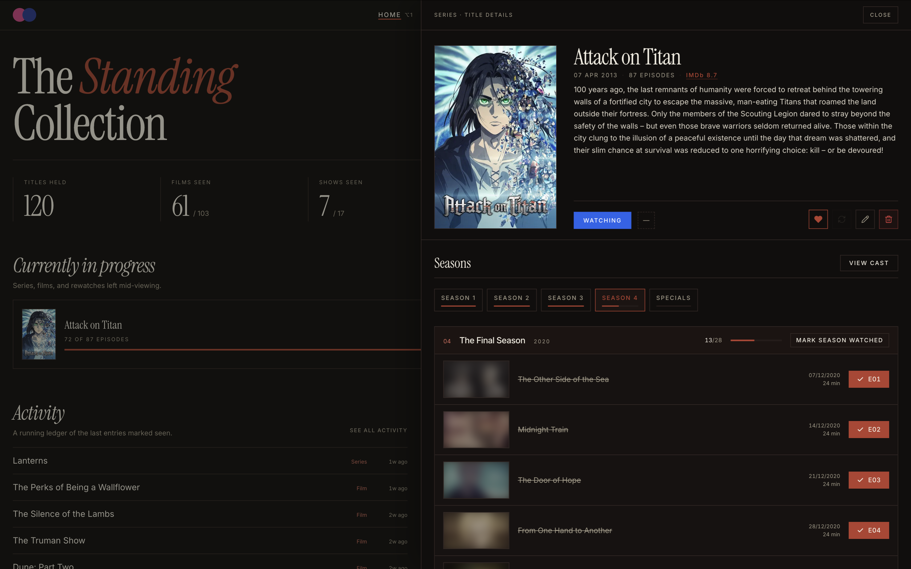

# CineTrack

CineTrack is a clean, personal tracker for movies and TV shows. It helps you organize what you want to watch, log what you have seen, and track your progress through seasons without social clutter. Everything stays private and saved directly on your own device.



## Why CineTrack?

Most modern trackers are overloaded with social feeds, algorithms, and ads. CineTrack takes a quieter approach. Inspired by physical cinema ledgers, it gives you a focused space to manage your shelf, look up titles, and log viewings. There are no accounts to create and no servers tracking your habits.

## Key Features

- **Personal Shelf:** Organize titles into Planned, Watching, Watched, and Dropped lists with custom ratings and notes.
- **Episode Tracking:** Check off episodes one by one, mark whole seasons, and track rewatches over time.
- **Discover & Search:** Browse trending movies and shows with rich metadata, posters, and cast details from TMDb.
- **Viewing Stats:** Review your viewing habits with monthly watch charts, total hours, and title breakdowns.
- **Private & Local:** Your library lives in your browser with local database storage. Export or restore backups anytime.
- **Custom Themes:** Choose between tailored themes like Velvet, Halide, and Blueprint to suit your taste.



## Built With

- **React 19 & TypeScript** for the user interface
- **Tailwind CSS** for the archival styling
- **Vite** for fast local development
- **SQLite (sql.js)** for in-browser data storage
- **TMDb API** for movie and television metadata

## Getting Started

### Prerequisites

You will need:
- [Node.js](https://nodejs.org/) (version 22.12 or newer)
- A free [TMDb API key](https://www.themoviedb.org/)

### Installation

1. Clone the repository and install dependencies:
   ```bash
   git clone https://github.com/your-username/cinetrack.git
   cd cinetrack
   npm install
   ```

2. Create a `.env` file in the project root and add your API key:
   ```env
   TMDB_KEY=your_api_key_here
   ```

3. Start the local server:
   ```bash
   npm run dev
   ```

Open the address shown in your terminal (usually `http://localhost:5173`) to start tracking. For a production build, run `npm run build` followed by `npm run start`.